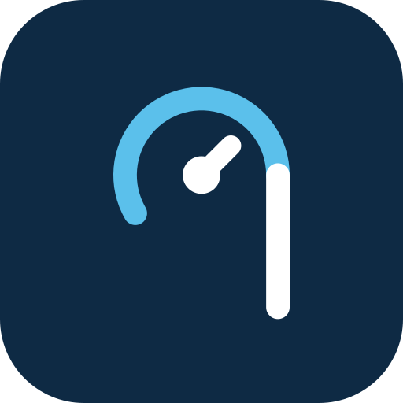

# Qilo

**A free app for QardioBase smart scales — no ads, no account, no cloud.**

> 🧪 **Beta — final testing (0.5.3).** Everything works on the developer's scale; we are now testing on more phones and scales. Bug reports and suggestions are very welcome — see [Help test Qilo](#help-test-qilo).

[Português](README.pt-BR.md) · [User manual](docs/manual-en.md) · [Privacy policy](PRIVACY.md)

The official Qardio app stopped working, and with it many QardioBase scales became paperweights. Qilo gives them back to their owners: it talks to the scale directly over Bluetooth and keeps every measurement on your phone.

> Qilo is an independent project. It is **not affiliated with, endorsed by or connected to Qardio, Inc.** "Qardio" and "QardioBase" are trademarks of their owners and are used here only to say which scales the app works with.

## Status

| | |
|---|---|
| Scale | QardioBase 2 (model B200, firmware 2.04) |
| Platform | Android 8.0 or newer (iOS planned) |
| Stage | Beta, final testing — testers wanted |

## Features

- **Weighing** with body composition: weight, BMI, body fat, water, muscle and bone (the scale's own estimates, in % and kg), lean mass and basal metabolic rate (Mifflin-St Jeor equation).
- **Profiles** for the whole family, each with its own name on the scale display (up to 6 lowercase letters or digits). The scale recognizes who is weighing; guest weighings are not saved.
- **Scale modes**: full, Smart Feedback, weight only and pregnancy.
- **Goals** by pace or by date, with a weekly target, progress and the trend of the last weeks. The goal is also sent to the scale.
- **History** as a chart, a list and a calendar of the days you weighed yourself, including upcoming reminder days. The list can **compare two weighings** side by side.
- **Notes** on each weighing, with ready-made tags (fasting, after workout, slept badly…) or your own text.
- **Reminders**: daily, weekly, every two weeks, monthly or every N days.
- **Health Connect**: sends weight and body fat so Google Fit, Samsung Health and other apps can read them.
- **App lock** with fingerprint, face or the phone's screen lock.
- **CSV export**, including an Excel-friendly format for Portuguese.
- **Scale tools**: link profiles that were already on the scale, turn Wi-Fi off, factory reset.
- Light and dark themes · English and Portuguese (Brazil).

## Wellness notice

Qilo is a wellness app. It only records the values sent by the scale and organizes them into charts and history. **It is not a medical device and does not diagnose, treat, cure, or prevent any medical condition.** References shown, such as the WHO BMI ranges, are informational and do not replace a professional assessment. For any health question, consult a healthcare professional.

Sources: BMI and ranges, World Health Organization · basal metabolic rate, Mifflin MD, St Jeor ST et al., *Am J Clin Nutr* 1990;51(2):241-7 · body composition: the scale's own bioimpedance estimate.

## Privacy

Everything stays on your phone. Qilo has no server and does not even request internet access. Data only leaves the phone when you export a CSV or turn on Health Connect. See the [privacy policy](PRIVACY.md).

## Getting the app

Download the latest APK from the [**Releases**](https://github.com/mattaneto/qilo/releases) page of this repository and open it on your phone (Android will ask you to allow installing apps from this source). A Play Store release is planned.

## Help test Qilo

If you have a QardioBase 2, you can help finish the beta:

1. Install the APK from [Releases](https://github.com/mattaneto/qilo/releases) and follow the [manual](docs/manual-en.md).
2. Something wrong? Open the ☰ menu › **Log (testing)** › **Copy log**, then [open a bug report](https://github.com/mattaneto/qilo/issues/new?template=bug.yml) and paste it. The log never contains Wi-Fi passwords.
3. Ideas and improvements: [open a suggestion](https://github.com/mattaneto/qilo/issues/new?template=suggestion.yml).

Other Qardio scales (QardioBase original, QardioBase X) are not supported yet. If you own one and can help test, say so in an issue.

**Looking for an iOS partner.** Qilo is built with Flutter, so an iPhone version is mostly platform work (Bluetooth permission, Apple Health, notifications). If you have a Mac, an Apple Developer account and would like to bring Qilo to iOS, please [get in touch](https://github.com/mattaneto/qilo/issues/new?template=suggestion.yml).

## Support the project

Qilo is free and will stay free. If it brought your scale back to life, you can support its development through **GitHub Sponsors** (the ❤ Sponsor button on this page).

## Credits

Developed by **Aluísio da Matta (Matta)** — [github.com/mattaneto](https://github.com/mattaneto) — with the help of AI (Claude, by Anthropic).
